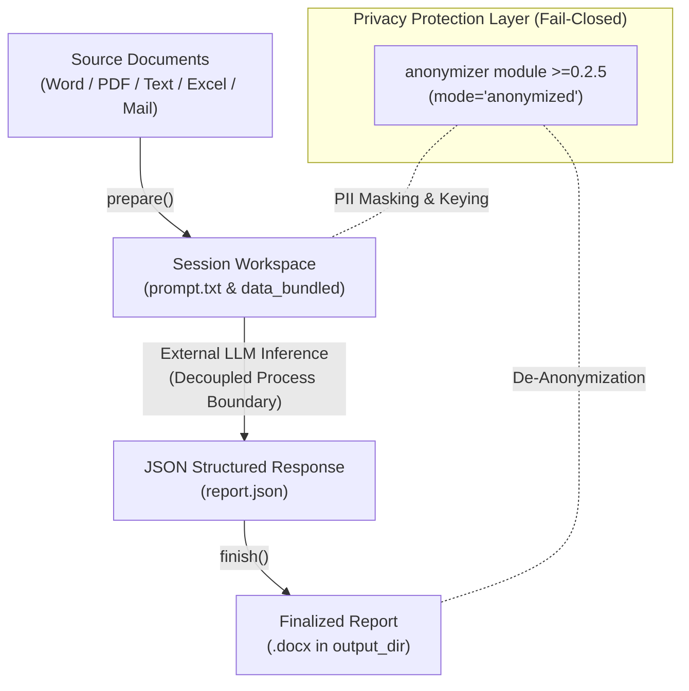
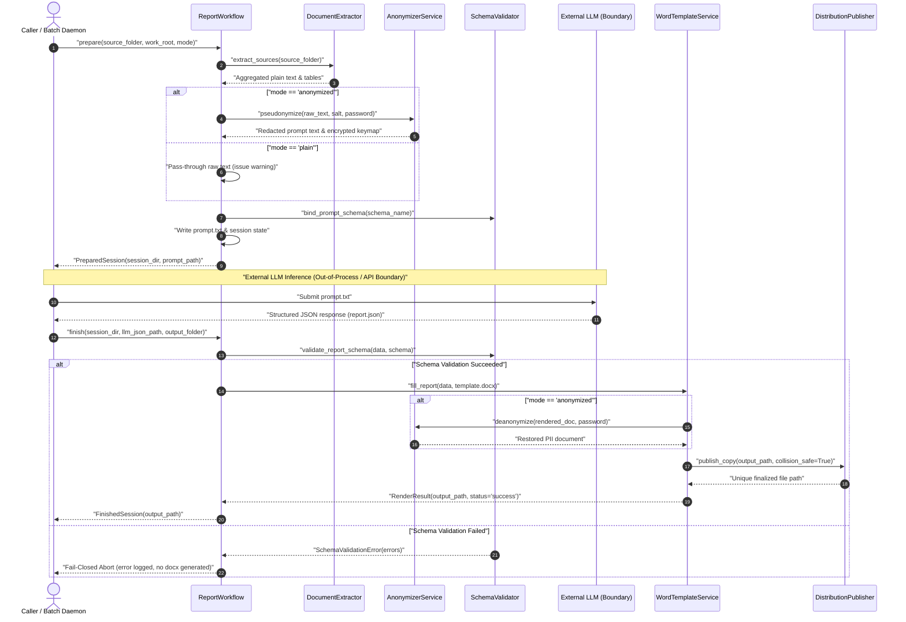

# report-forge


Language: [English](README.md) | [Deutsch](README_de.md)


> [!NOTE]
> This repository is optimized for AI agents and automated workflows. Machine-readable specifications, runtime invariants, and integration blueprints can be found in [`llms.txt`](llms.txt), [`SKILL.md`](SKILL.md), and [`MARKETING-LOG.txt`](MARKETING-LOG.txt).

Domain-neutral core engine for schema-bound, anonymizable report generation pipelines: extract source documents → build LLM prompt bound to a JSON schema → populate Word (`.docx`) template with structured LLM responses. Privacy modes switchable between `mode="anonymized"` (GDPR Art. 4(5) fail-closed pseudonymization) and `mode="plain"`.

---

## Table of Contents

- [System Architecture](#system-architecture)
- [Lifecycle Sequence](#lifecycle-sequence)
- [Feature Overview](#feature-overview)
- [Installation](#installation)
- [Quick Start](#quick-start)
- [Template Engine & Placeholders](#template-engine--placeholders)
- [Batch Inbox & Publishing](#batch-inbox--publishing)
- [CLI Usage](#cli-usage)
- [Governance & Runtime Invariants](#governance--runtime-invariants)
- [Sister Repositories & Ecosystem](#sister-repositories--ecosystem)
- [Testing & Verification](#testing--verification)
- [Security & Privacy](#security--privacy)
- [License](#license)

---

## 🏗️ System Architecture



---

## 🔄 Lifecycle Sequence

The sequence diagram below visualizes the decoupled 3-phase execution lifecycle, highlighting the privacy boundary, external inference separation, and fail-closed schema validation:



---

## ⚡ Feature Overview

| Feature | Description | Invariant |
|---|---|---|
| **3-Phase Pipeline** | Clean separation of extraction (`prepare`), external inference, and rendering (`finish`) | `INV-FORGE-01` |
| **Fail-Closed Privacy** | Pseudonymization & Fernet encryption (`mode="anonymized"`) via `anonymizer` module (≥0.2.5) | `INV-FORGE-03` |
| **Schema Validation** | Strict JSON Schema validation (Draft 2020-12 / Draft 7) prior to document rendering | `INV-FORGE-02` |
| **Word Template Engine** | Deterministic `.docx` replacement (`{{KEY}}`, multi-run tokens, dynamic tables, checkboxes) | `INV-FORGE-04` |
| **Batch Inbox Runner** | Idempotent `process-inbox` automation with work locks and error quarantine | `INV-FORGE-06` |
| **Publishing & Storage** | Collision-safe copying to designated `output_dir` with millisecond timestamp protection | `INV-FORGE-05` |
| **Non-Interactive CLI** | Headless CI/daemon execution via `--*-env` variable resolution with zero stdout secret leakage | `INV-FORGE-07` |
| **Local-First & Offline** | Complete zero-egress architecture; zero unexpected remote network calls or telemetry | `INV-FORGE-08` |

---

## 📦 Installation

```bash
pip install .
pip install ".[formats]"  # Optional: PDF, Excel, and Outlook MSG extraction
```

The canonical runtime versions and optional format extras are declared in `pyproject.toml`. Optional anonymization requires the separately installed `anonymizer` module ≥0.2.5.

---

## 🚀 Quick Start

### 1. Plain Mode (`mode="plain"`, unencrypted)

```python
from pathlib import Path
from report_forge.workflow import ReportWorkflow

workflow = ReportWorkflow()

# Phase 1: Read source documents and construct schema-bound prompt
prepared = workflow.prepare(
    source_folder=Path("source_docs/"),
    work_root=Path("sessions/"),
    mode="plain",
)
print(f"Session workspace initialized: {prepared.session_dir}")
print(f"Prompt prepared at: {prepared.prompt_path}")

# Phase 2: Execute external LLM (outside module boundary)
#          Save JSON output to: prepared.session_dir / "data_bundled" / "report.json"

# Phase 3: Validate JSON response, populate Word template, and publish report
finished = workflow.finish(
    session_dir=prepared.session_dir,
    llm_json_path=prepared.session_dir / "data_bundled" / "report.json",
    output_folder=Path("output/final_report.docx"),
)
print(f"Report successfully rendered: {finished.output_path}")
```

### 2. Anonymized Mode (`mode="anonymized"`, Default)

When running in `mode="anonymized"`, personal identifiers are pseudonymized prior to prompt construction:

```python
prepared = workflow.prepare(
    source_folder=Path("client_docs/"),
    work_root=Path("sessions/"),
    mode="anonymized",
    real_name="Max Mustermann",
    birth_date="2012-05-14",
    password="secure-user-passphrase",
)

# During finish(), provide the password to restore real identifiers in the final DOCX:
finished = workflow.finish(
    session_dir=prepared.session_dir,
    llm_json_path=prepared.session_dir / "data_bundled" / "report.json",
    output_folder=Path("output/final_report.docx"),
    password="secure-user-passphrase",
)
```

---

## 📝 Template Engine & Placeholders

`report-forge` includes a resilient `.docx` template engine (`WordTemplateService`):

1. **Simple Placeholders (`{{KEY}}`)**:
   Replaces tokens in paragraphs, table cells, headers, and footers, including tokens fragmented across multiple Word XML runs (`w:r`).
2. **Dynamic Table Rows (`fill_table_rows`)**:
   Clones template rows dynamically according to JSON array data, matching keys to configured table column mappings.
3. **ICF / Key-Field Table Patterns (`{CODE-Field}`)**:
   Fills matching code-field placeholders and purges rows devoid of data.
4. **Checkbox Toggling (`[X]` / `[ ]`)**:
   Toggles checkbox state characters or Wingdings glyphs deterministically based on boolean schema flags.

---

## 📥 Batch Inbox & Publishing

Configure directory targets in `config.json` or `config.local.json`:
- **`output_dir`**: Central destination directory for collision-proof report publication.
- **`inbox_dir`**: Input pickup directory for the automated batch runner `process-inbox`.

```bash
# Run inbox processor in dry-run mode
python -m report_forge process-inbox --work sessions/ --mode plain --dry-run
```

---

## 💻 CLI Usage

`report-forge` provides a full suite of CLI commands:

```bash
# Prepare a session prompt from source files
python -m report_forge prepare source_docs/ --work sessions/ --mode plain

# Validate and render from a completed LLM JSON
python -m report_forge finish sessions/20260911_010000 --json sessions/20260911_010000/data_bundled/report.json --output dist/

# Run the automated inbox processor
python -m report_forge process-inbox --work sessions/ --mode plain

# Inspect available schemas and templates
python -m report_forge info
```

### Non-Interactive & Headless CI Mode

Interactive terminal runs preserve hidden `getpass` prompts. In non-interactive environments (CI runners, cron daemons, pipes), resolve secrets via environment variables:

- `REPORT_FORGE_REAL_NAME`, `REPORT_FORGE_BIRTH_DATE`, `REPORT_FORGE_PASSWORD` for `prepare`
- `REPORT_FORGE_PASSWORD` for `finish`
- `REPORT_FORGE_INBOX_PASSWORD` for `process-inbox`

The `--*-env` options accept environment variable names only (never raw secret values). Missing secrets in non-TTY mode terminate with exit code 2 immediately (fail-closed). Secrets are never printed to stdout or log files.

---

## 🛡️ Governance & Runtime Invariants

The `report-forge` architecture guarantees the following 8 runtime invariants:

| Identifier | Invariant Name | Formal Specification |
|---|---|---|
| `INV-FORGE-01` | **3-Phase Architectural Separation** | `prepare()`, external inference, and `finish()` remain strictly separated; inference never occurs in-process. |
| `INV-FORGE-02` | **Schema-Bound Output Gate** | LLM JSON output must pass strict JSON Schema validation (Draft 2020-12 / Draft 7) prior to template rendering. |
| `INV-FORGE-03` | **Fail-Closed Privacy Boundary** | `mode="anonymized"` requires `anonymizer` ≥0.2.5; missing dependencies or keys halt execution immediately without cleartext fallback. |
| `INV-FORGE-04` | **Template Engine Integrity** | Multi-run XML placeholder substitutions and table expansions preserve valid OpenXML markup without corruption. |
| `INV-FORGE-05` | **Collision-Safe Distribution** | Output copies to `output_dir` use millisecond timestamps and collision counters to prevent overwriting existing files. |
| `INV-FORGE-06` | **Idempotent Batch State** | `process-inbox` isolates items with atomic locks, sorting completed items into archive and malformed items into quarantine. |
| `INV-FORGE-07` | **Secret Leakage Prevention** | Secrets are resolved exclusively via secure TTY prompts or environment variable names, never logged or displayed. |
| `INV-FORGE-08` | **Zero Unexpected Network Egress** | All document extraction, prompt generation, schema validation, and rendering execute 100% local-first. |

---

## 🌐 Sister Repositories & Ecosystem

`report-forge` functions as the core reporting engine within the broader open-source ecosystem:

| Repository | Role & Focus | Integration Point |
|---|---|---|
| [`anonymizer`](https://github.com/ellmos-ai/anonymizer) | PII Masking & Cryptographic Engine | Privacy protection layer for `mode="anonymized"` |
| [`foerderplaner`](https://github.com/ellmos-ai/foerderplaner) | Educational & Assessment Domain Overlay | Domain overlay implementing ICF schemas and school report templates |
| [`worksheet-generator`](https://github.com/ellmos-ai/worksheet-generator) | Educational Task Sheet Compiler | Generates complementary exercise sheets and instructional handouts |
| [`coma`](https://github.com/ellmos-ai/coma) | Headless Multi-Agent Harness | Orchestrates autonomous background report processing pipelines |
| [`usmc`](https://github.com/ellmos-ai/usmc) | Universal State Machine Controller | Governs batch pipeline transitions and lifecycle safety |
| [`open-bricks`](https://github.com/open-bricks) | Umbrella Developer Tool Ecosystem | Cross-project governance, standards, and packaging |

---

## 🧪 Testing & Verification

Run the comprehensive pytest suite:

```bash
PYTHONIOENCODING=utf-8 python -m pytest tests/ -ra -q
```

All 43 tests verify:
- Functional 3-phase workflows (plain & anonymized prepare/finish)
- DOCX template placeholder substitution & dynamic table generation
- JSON schema validation gates & error formatting
- Batch inbox processing state machine & collision protection
- PEP 621 metadata, extended URLs, `.gitignore` hygiene, CI matrix, and documentation parity

---

## 🔒 Security & Privacy

`report-forge` enforces strict local-first processing, zero unexpected network egress, and fail-closed pseudonymization. For vulnerability disclosures and security policies, see [SECURITY.md](SECURITY.md).

- **SLA**: Initial response within 48 hours; status update and triage within 5 business days.
- **Contact**: `security@ellmos.ai` / `security@open-bricks.org`

---

## 📄 License

Distributed under the MIT License. See [LICENSE](LICENSE) for full details.
