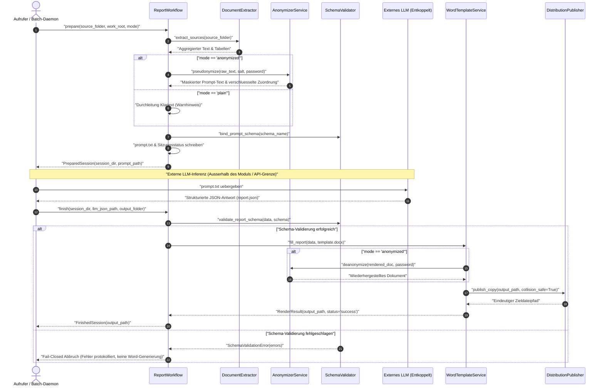

# report-forge



Language: [English](README.md) | [Deutsch](README_de.md)


> [!NOTE]
> Dieses Repository ist für KI-Agenten und automatisierte Workflows optimiert. Maschinenlesbare Spezifikationen, Laufzeit-Invarianten und Integrations-Blueprints befinden sich in [`llms.txt`](llms.txt), [`SKILL.md`](SKILL.md) sowie [`MARKETING-LOG.txt`](MARKETING-LOG.txt).

Domänen-neutraler Kern für schema-gebundene, anonymisierbare Berichts-Pipelines: Quelldokumente extrahieren → LLM-Prompt gegen ein konfigurierbares JSON-Schema erzeugen → Word-Vorlage mit dem strukturierten LLM-Ergebnis befüllen. Datenschutzmodi schaltbar zwischen `mode="anonymized"` (DSGVO Art. 4(5) Fail-Closed Pseudonymisierung) und `mode="plain"`.

---

## Inhaltsverzeichnis

- [Systemarchitektur](#systemarchitektur)
- [Lebenszyklus-Sequenz](#lebenszyklus-sequenz)
- [Funktionsübersicht](#funktionsübersicht)
- [Installation](#installation)
- [Schnellstart](#schnellstart)
- [Vorlagen-Engine & Platzhalter](#vorlagen-engine--platzhalter)
- [Batch-Abholort & Veröffentlichung](#batch-abholort--veröffentlichung)
- [CLI-Befehle](#cli-befehle)
- [Governance- & Laufzeit-Invarianten](#governance---laufzeit-invarianten)
- [Geschwister-Repositories & Ökosystem](#geschwister-repositories--ökosystem)
- [Tests & Verifikation](#tests--verifikation)
- [Sicherheit & Datenschutz](#sicherheit--datenschutz)
- [Lizenz](#lizenz)

---

## 🏗️ Systemarchitektur

```mermaid
flowchart TD
    A["Quelldokumente<br/>(Word / PDF / Text / Excel / Mail)"] -->|"prepare()"| B["Session Workspace<br/>(prompt.txt & data_bundled)"]
    B -->|"Externe LLM-Inferenz<br/>(Entkoppelte Prozessgrenze)"| C["Strukturierte JSON-Antwort<br/>(report.json)"]
    C -->|"finish()"| D["Finaler Bericht<br/>(.docx in output_dir)"]

    subgraph PrivacyLayer ["Datenschutz-Schicht (Fail-Closed)"]
        E["anonymizer-Modul &gt;=0.2.5<br/>(mode='anonymized')"]
    end
    E -.-|"PII-Maskierung &amp; Verschl."| B
    E -.-|"De-Anonymisierung"| D
```



---

## 🔄 Lebenszyklus-Sequenz

Das nachfolgende Sequenzdiagramm veranschaulicht den entkoppelten 3-Phasen-Ausführungszyklus, die Datenschutzgrenze, die externe LLM-Inferenz sowie die Fail-Closed Schema-Validierung:



---

## ⚡ Funktionsübersicht

| Merkmal | Beschreibung | Invariante |
|---|---|---|
| **3-Phasen Pipeline** | Klare Trennung von Extraktion (`prepare`), externer Inferenz und Rendering (`finish`) | `INV-FORGE-01` |
| **Fail-Closed Datenschutz** | Pseudonymisierung & Fernet-Verschlüsselung (`mode="anonymized"`) via `anonymizer`-Modul (≥0.2.5) | `INV-FORGE-03` |
| **Schema-Validierung** | Strenge Prüfung gegen JSON-Schema (Draft 2020-12 / Draft 7) vor Vorlagenbefüllung | `INV-FORGE-02` |
| **Word-Vorlagenengine** | Deterministisches `.docx`-Ersetzen (`{{PLATZHALTER}}`, Multi-Run-Tokens, dynamische Zeilen, Checkboxen) | `INV-FORGE-04` |
| **Batch-Abholort** | Idempotenter `process-inbox`-Runner mit Dateisperren und Fehler-Quarantäne | `INV-FORGE-06` |
| **Veröffentlichung & Speicher** | Kollisionssichere Verteilung nach `output_dir` mit Millisekunden-Zeitstempelung | `INV-FORGE-05` |
| **Nicht-interaktive CLI** | Headless CI-/Dienst-Ausführung via `--*-env` Variablen-Auflösung ohne Secret-Leaks in stdout | `INV-FORGE-07` |
| **Local-First & Offline** | Vollständige Zero-Egress-Architektur; keinerlei unerwartete Netzwerkaufrufe oder Telemetrie | `INV-FORGE-08` |

---

## 📦 Installation

```bash
pip install .
pip install ".[formats]"  # Optional: PDF-, Excel- und Outlook-MSG-Extraktion
```

Die kanonischen Runtime-Versionen und optionalen Format-Extras sind in `pyproject.toml` deklariert. Optionale Anonymisierung erfordert das separat installierte Modul `anonymizer` ≥0.2.5.

---

## 🚀 Schnellstart

### 1. Ohne Anonymisierung (`mode="plain"`, unverschlüsselt)

```python
from pathlib import Path
from report_forge.workflow import ReportWorkflow

workflow = ReportWorkflow()

# Phase 1: Quelldaten lesen und schema-gebundenen Prompt vorbereiten
prepared = workflow.prepare(
    source_folder=Path("quell_dokumente/"),
    work_root=Path("sitzungen/"),
    mode="plain",
)
print(f"Sitzungsverzeichnis initialisiert: {prepared.session_dir}")
print(f"Prompt vorbereitet unter: {prepared.prompt_path}")

# Phase 2: Externes LLM aufrufen (außerhalb des Moduls)
#          JSON-Ergebnis speichern unter: prepared.session_dir / "data_bundled" / "report.json"

# Phase 3: JSON-Ergebnis validieren, Word-Vorlage befüllen und Bericht veröffentlichen
finished = workflow.finish(
    session_dir=prepared.session_dir,
    llm_json_path=prepared.session_dir / "data_bundled" / "report.json",
    output_folder=Path("output/fertiger_bericht.docx"),
)
print(f"Bericht erfolgreich generiert: {finished.output_path}")
```

### 2. Anonymisierter Modus (`mode="anonymized"`, Default)

Im Modus `mode="anonymized"` werden personenbezogene Identifikatoren vor dem Prompt-Bau pseudonymisiert:

```python
prepared = workflow.prepare(
    source_folder=Path("klienten_daten/"),
    work_root=Path("sitzungen/"),
    mode="anonymized",
    real_name="Max Mustermann",
    birth_date="2012-05-14",
    password="sichere-benutzer-passphrase",
)

# Bei finish() wird das Passwort übergeben, um die Klardaten im fertigen DOCX wiederherzustellen:
finished = workflow.finish(
    session_dir=prepared.session_dir,
    llm_json_path=prepared.session_dir / "data_bundled" / "report.json",
    output_folder=Path("output/fertiger_bericht.docx"),
    password="sichere-benutzer-passphrase",
)
```

---

## 📝 Vorlagen-Engine & Platzhalter

`report-forge` enthält eine robuste `.docx`-Vorlagen-Engine (`WordTemplateService`):

1. **Einfache Platzhalter (`{{PLATZHALTER}}`)**:
   Ersetzt Tokens in Absätzen, Tabellenzellen sowie Kopf- und Fußzeilen, auch wenn das Token über mehrere Word-XML-Runs (`w:r`) fragmentiert ist.
2. **Dynamische Tabellenzeilen (`fill_table_rows`)**:
   Dupliziert Vorlagenzeilen dynamisch anhand von JSON-Array-Daten und mappt Schlüssel auf konfigurierte Tabellenspalten.
3. **ICF- / Schlüssel-Feld-Tabellenmuster (`{CODE-Feld}`)**:
   Befüllt passende Code-Feld-Platzhalter und entfernt Leerzeilen ohne Daten.
4. **Checkbox-Steuerung (`[X]` / `[ ]`)**:
   Schaltet Checkbox-Zeichen oder Wingdings-Glyphen anhand boolescher Schema-Werte deterministisch um.

---

## 📥 Batch-Abholort & Veröffentlichung

Konfigurierbare Verzeichnisse in `config.json` oder `config.local.json`:
- **`output_dir`**: Zentraler Zielordner für kollisionsfreie Berichtsveröffentlichung.
- **`inbox_dir`**: Abholort für den automatisierten Batch-Runner `process-inbox`.

```bash
# Batch-Verarbeitung im Testlauf (dry-run)
python -m report_forge process-inbox --work sitzungen/ --mode plain --dry-run
```

---

## 💻 CLI-Befehle

`report-forge` bietet eine vollständige CLI-Befehlsübersicht:

```bash
# Sitzungsprompt aus Quelldateien vorbereiten
python -m report_forge prepare quell_dokumente/ --work sitzungen/ --mode plain

# Validieren und Rendern aus fertiger LLM-JSON
python -m report_forge finish sitzungen/20260911_010000 --json sitzungen/20260911_010000/data_bundled/report.json --output dist/

# Automatisierten Batch-Inbox-Runner ausführen
python -m report_forge process-inbox --work sitzungen/ --mode plain

# Verfügbare Schemas und Vorlagen inspizieren
python -m report_forge info
```

### Nicht-interaktiver & Headless CI-Modus

Interaktive Terminalaufrufe nutzen verdeckte `getpass`-Abfragen. In Headless-Umgebungen (CI-Runner, Cron-Jobs, Pipes) werden Secrets über Umgebungsvariablen aufgelöst:

- `REPORT_FORGE_REAL_NAME`, `REPORT_FORGE_BIRTH_DATE`, `REPORT_FORGE_PASSWORD` für `prepare`
- `REPORT_FORGE_PASSWORD` für `finish`
- `REPORT_FORGE_INBOX_PASSWORD` für `process-inbox`

Die `--*-env`-Optionen nehmen ausschließlich Variablennamen entgegen (niemals Secret-Werte im Klartext). Fehlt ein Secret im Nicht-TTY-Modus, bricht der Lauf sofort mit Exit-Code 2 ab (Fail-Closed). Secrets werden zu keinem Zeitpunkt in stdout oder Logdateien ausgegeben.

---

## 🛡️ Governance- & Laufzeit-Invarianten

Die Architektur von `report-forge` garantiert die folgenden 8 Laufzeit-Invarianten:

| Bezeichner | Invarianten-Name | Formale Spezifikation |
|---|---|---|
| `INV-FORGE-01` | **Drei-Phasen-Architekturtrennung** | `prepare()`, externe Inferenz und `finish()` bleiben strikt getrennt; Inferenz findet niemals im Modulprozess statt. |
| `INV-FORGE-02` | **Schema-gebundenes Output-Gate** | LLM-JSON muss vor der Vorlagenbefüllung die strenge JSON-Schema-Validierung (Draft 2020-12 / Draft 7) fehlerfrei bestehen. |
| `INV-FORGE-03` | **Fail-Closed Datenschutzgrenze** | `mode="anonymized"` erfordert `anonymizer` ≥0.2.5; fehlende Schlüssel oder Module brechen sofort ab, kein stiller Klartext-Fallback. |
| `INV-FORGE-04` | **Vorlagen-Engine-Integrität** | Multi-Run XML-Platzhalterersetzung und dynamische Tabellen wahren gültiges OpenXML-Markup ohne Dokumentkorruption. |
| `INV-FORGE-05` | **Kollisionsfreie Verteilung** | Kopien nach `output_dir` nutzen Millisekunden-Zeitstempel und Kollisionszähler, um Überschreibungen auszuschließen. |
| `INV-FORGE-06` | **Idempotenter Batch-Zustand** | `process-inbox` sperrt Einheiten atomar; erfolgreiche Fälle wandern ins Archiv, fehlerhafte Fälle in Quarantäne. |
| `INV-FORGE-07` | **Secret-Schutz vor Leaks** | Secrets werden nur über geschützte TTY-Prompts oder Umgebungsvariablen aufgelöst, niemals geloggt oder angezeigt. |
| `INV-FORGE-08` | **Null unerwarteter Netzwerk-Egress** | Gesamte Extraktion, Prompt-Generierung, Schema-Validierung und Word-Befüllung laufen 100% lokal ab. |

---

## 🌐 Geschwister-Repositories & Ökosystem

`report-forge` bildet den Pipeline-Kern innerhalb des Open-Source-Ökosystems:

| Repository | Rolle & Schwerpunkt | Integrationspunkt |
|---|---|---|
| [`anonymizer`](https://github.com/ellmos-ai/anonymizer) | PII-Maskierung & Kryptographie-Engine | Datenschutzschicht für `mode="anonymized"` |
| [`foerderplaner`](https://github.com/ellmos-ai/foerderplaner) | Diagnostik- und Förderberichts-Overlay | Domänen-Overlay mit ICF-Schemas und Berichts-Layouts |
| [`worksheet-generator`](https://github.com/ellmos-ai/worksheet-generator) | Arbeitsblatt- und Aufgabengenerator | Erzeugt begleitende Übungs- und Lehrmaterialien |
| [`coma`](https://github.com/ellmos-ai/coma) | Headless Multi-Agenten-Harness | Orchestriert autonome Hintergrundläufe für Berichte |
| [`usmc`](https://github.com/ellmos-ai/usmc) | Universelle Zustandsmaschinen-Steuerung | Steuert Batch-Übergänge und Lebenszyklus-Sicherheit |
| [`open-bricks`](https://github.com/open-bricks) | Dachorganisation für Developer Tools | Governance, Qualitätsstandards und Paketierung |

---

## 🧪 Tests & Verifikation

Ausführen der pytest-Suite:

```bash
PYTHONIOENCODING=utf-8 python -m pytest tests/ -ra -q
```

Alle 43 Tests prüfen:
- Funktionale 3-Phasen-Workflows (Plain & Anonymisiert prepare/finish)
- Word-Vorlagen Platzhalterersetzung & dynamische Tabellengenerierung
- JSON-Schema-Validierungs-Gates & Fehlerformatierung
- Batch-Inbox Zustandsmaschine & Kollisionsschutz
- PEP 621 Metadaten, erweiterte URLs, `.gitignore`-Hygiene, CI-Matrix und bilinguale Dokumentationsparität

---

## 🔒 Sicherheit & Datenschutz

`report-forge` erzwingt strikte Local-First-Verarbeitung, null unerwarteten Netzwerkabfluss und Fail-Closed-Pseudonymisierung. Richtlinien zur Schwachstellenmeldung und Reaktionsfristen finden sich in [SECURITY.md](SECURITY.md).

- **SLA**: Erstreaktion innerhalb von 48 Stunden; Triage und Statusupdate innerhalb von 5 Werktagen.
- **Kontakt**: `security@ellmos.ai` / `security@open-bricks.org`

---

## 📄 Lizenz

Veröffentlicht unter der MIT-Lizenz. Vollständiger Text siehe [LICENSE](LICENSE).
