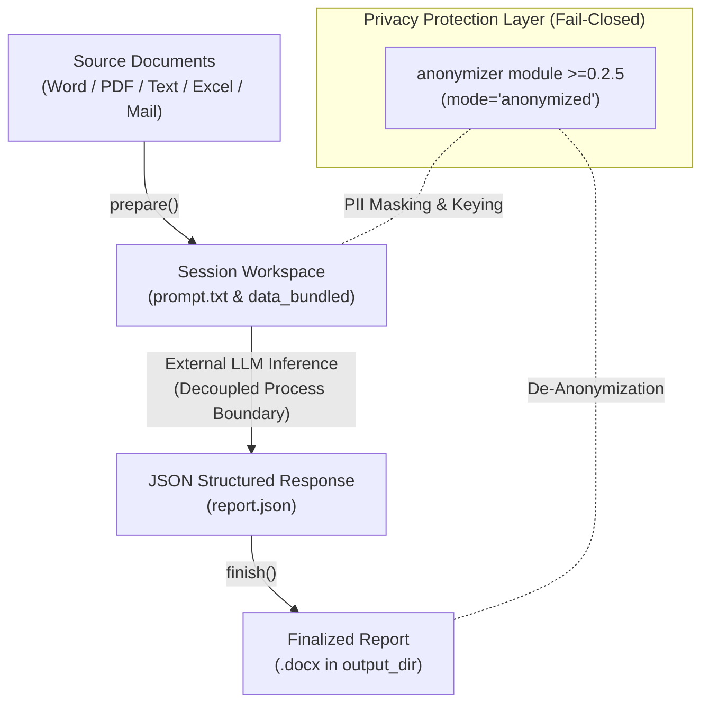
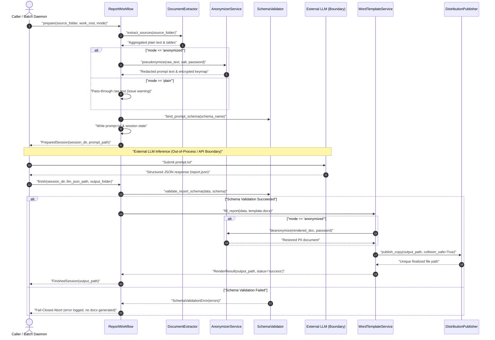

<!-- worldset: {"translated_from_sha256": "224155cb9a04bb1aa65215156fbc64d051d512d3afd8e3422d9a5e3d96016fb5", "translator": "gpt-6-luna", "translated_at": "2026-10-28T21:34:00+00:00"} -->

# report-forge



Idioma: [English](README.md) | [Deutsch](README_de.md) | [Español](README_es.md)


> [!NOTE]
> Este repositorio está optimizado para agentes de IA y flujos de trabajo automatizados. Las especificaciones legibles por máquinas, las invariantes en tiempo de ejecución y los planos de integración se encuentran en [`llms.txt`](llms.txt), [`SKILL.md`](SKILL.md) y [`MARKETING-LOG.txt`](MARKETING-LOG.txt).

Motor central independiente del dominio para canalizaciones de generación de informes vinculadas a esquemas y con posibilidad de anonimización: extrae documentos de origen → crea un prompt para un LLM sujeto a un esquema JSON → rellena una plantilla de Word (`.docx`) con respuestas estructuradas del LLM. Los modos de privacidad se pueden alternar entre `mode="anonymized"` (seudonimización con denegación segura ante fallos, según el art. 4, apdo. 5, del RGPD) y `mode="plain"`.

---

## Índice

- [Arquitectura del sistema](#arquitectura-del-sistema)
- [Secuencia del ciclo de vida](#secuencia-del-ciclo-de-vida)
- [Resumen de funciones](#resumen-de-funciones)
- [Instalación](#instalacion)
- [Inicio rápido](#inicio-rapido)
- [Motor de plantillas y marcadores](#motor-de-plantillas-y-marcadores)
- [Bandeja de entrada por lotes y publicación](#bandeja-de-entrada-por-lotes-y-publicacion)
- [Uso de la CLI](#uso-de-la-cli)
- [Gobernanza e invariantes de ejecución](#gobernanza-e-invariantes-de-ejecucion)
- [Repositorios hermanos y ecosistema](#repositorios-hermanos-y-ecosistema)
- [Pruebas y verificación](#pruebas-y-verificacion)
- [Seguridad y privacidad](#seguridad-y-privacidad)
- [Licencia](#licencia)

---

<a id="arquitectura-del-sistema"></a>
## 🏗️ Arquitectura del sistema



---

<a id="secuencia-del-ciclo-de-vida"></a>
## 🔄 Secuencia del ciclo de vida

El diagrama de secuencia siguiente ilustra el ciclo de ejecución desacoplado en tres fases y destaca el límite de privacidad, la separación de la inferencia externa y la validación del esquema con denegación segura ante fallos:



---

<a id="resumen-de-funciones"></a>
## ⚡ Resumen de funciones

| Función | Descripción | Invariante |
|---|---|---|
| **Canalización en 3 fases** | Separa claramente la extracción (`prepare`), la inferencia externa y la generación (`finish`) | `INV-FORGE-01` |
| **Privacidad con denegación segura ante fallos** | Seudonimización y cifrado Fernet (`mode="anonymized"`) mediante el módulo `anonymizer` (≥0.2.5) | `INV-FORGE-03` |
| **Validación de esquemas** | Validación estricta con JSON Schema (Draft 2020-12 / Draft 7) antes de generar el documento | `INV-FORGE-02` |
| **Motor de plantillas de Word** | Sustitución determinista en `.docx` (`{{KEY}}`, marcadores repartidos entre elementos XML (`w:r`), tablas dinámicas y casillas) | `INV-FORGE-04` |
| **Procesador por lotes de la bandeja de entrada** | Automatización idempotente de `process-inbox` con bloqueos de trabajo y cuarentena de errores | `INV-FORGE-06` |
| **Publicación y almacenamiento** | Copia sin colisiones en el `output_dir` designado, protegida con marcas de tiempo de milisegundos | `INV-FORGE-05` |
| **CLI no interactiva** | Ejecución sin interfaz para CI/daemons mediante la resolución de variables `--*-env`, sin filtrar secretos por stdout | `INV-FORGE-07` |
| **Local primero y sin conexión** | Arquitectura completa de cero salida de red; sin llamadas remotas inesperadas ni telemetría | `INV-FORGE-08` |

---

<a id="instalacion"></a>
## 📦 Instalación

```bash
pip install .
pip install ".[formats]"  # Optional: PDF, Excel, and Outlook MSG extraction
```

Las versiones canónicas del entorno de ejecución y los extras de formatos opcionales se declaran en `pyproject.toml`. La anonimización opcional requiere instalar por separado el módulo `anonymizer` ≥0.2.5.

---

<a id="inicio-rapido"></a>
## 🚀 Inicio rápido

### 1. Modo sin anonimización (`mode="plain"`, sin cifrar)

```python
from pathlib import Path
from report_forge.workflow import ReportWorkflow

workflow = ReportWorkflow()

# Phase 1: Read source documents and construct schema-bound prompt
prepared = workflow.prepare(
    source_folder=Path("source_docs/"),
    work_root=Path("sessions/"),
    mode="plain",
)
print(f"Session workspace initialized: {prepared.session_dir}")
print(f"Prompt prepared at: {prepared.prompt_path}")

# Phase 2: Execute external LLM (outside module boundary)
#          Save JSON output to: prepared.session_dir / "data_bundled" / "report.json"

# Phase 3: Validate JSON response, populate Word template, and publish report
finished = workflow.finish(
    session_dir=prepared.session_dir,
    llm_json_path=prepared.session_dir / "data_bundled" / "report.json",
    output_folder=Path("output/final_report.docx"),
)
print(f"Report successfully rendered: {finished.output_path}")
```

### 2. Modo anonimizado (`mode="anonymized"`, predeterminado)

Al ejecutar en modo `mode="anonymized"`, los identificadores personales se seudonimizan antes de construir el prompt:

```python
prepared = workflow.prepare(
    source_folder=Path("client_docs/"),
    work_root=Path("sessions/"),
    mode="anonymized",
    real_name="Max Mustermann",
    birth_date="2012-05-14",
    password="secure-user-passphrase",
)

# During finish(), provide the password to restore real identifiers in the final DOCX:
finished = workflow.finish(
    session_dir=prepared.session_dir,
    llm_json_path=prepared.session_dir / "data_bundled" / "report.json",
    output_folder=Path("output/final_report.docx"),
    password="secure-user-passphrase",
)
```

---

<a id="motor-de-plantillas-y-marcadores"></a>
## 📝 Motor de plantillas y marcadores

`report-forge` incluye un motor resistente de plantillas `.docx` (`WordTemplateService`):

1. **Marcadores simples (`{{KEY}}`)**:
   Sustituye tokens en párrafos, celdas de tablas, encabezados y pies de página, incluso cuando el token se reparte entre varios elementos XML de Word (`w:r`).
2. **Filas dinámicas de tablas (`fill_table_rows`)**:
   Clona filas de la plantilla de forma dinámica según los datos de matrices JSON y asigna las claves a las columnas configuradas.
3. **Patrones de tablas ICF y de campos clave (`{CODE-Field}`)**:
   Rellena los marcadores de código y campo correspondientes y elimina las filas que no contienen datos.
4. **Activación de casillas (`[X]` / `[ ]`)**:
   Cambia de forma determinista los caracteres de las casillas o los glifos Wingdings según los indicadores booleanos del esquema.

---

<a id="bandeja-de-entrada-por-lotes-y-publicacion"></a>
## 📥 Bandeja de entrada por lotes y publicación

Configura los directorios de destino en `config.json` o `config.local.json`:
- **`output_dir`**: destino central para publicar informes sin colisiones.
- **`inbox_dir`**: directorio de entrada que recoge los documentos para el procesador automatizado `process-inbox`.

```bash
# Run inbox processor in dry-run mode
python -m report_forge process-inbox --work sessions/ --mode plain --dry-run
```

---

<a id="uso-de-la-cli"></a>
## 💻 Uso de la CLI

`report-forge` ofrece un conjunto completo de comandos CLI:

```bash
# Prepare a session prompt from source files
python -m report_forge prepare source_docs/ --work sessions/ --mode plain

# Validate and render from a completed LLM JSON
python -m report_forge finish sessions/20260911_010000 --json sessions/20260911_010000/data_bundled/report.json --output dist/

# Run the automated inbox processor
python -m report_forge process-inbox --work sessions/ --mode plain

# Inspect available schemas and templates
python -m report_forge info
```

### Modo no interactivo y CI sin interfaz

Las ejecuciones en terminal interactiva conservan las solicitudes ocultas de `getpass`. En entornos no interactivos (ejecutores de CI, daemons cron y tuberías), las credenciales se resuelven mediante variables de entorno:

- `REPORT_FORGE_REAL_NAME`, `REPORT_FORGE_BIRTH_DATE`, `REPORT_FORGE_PASSWORD` para `prepare`
- `REPORT_FORGE_PASSWORD` para `finish`
- `REPORT_FORGE_INBOX_PASSWORD` para `process-inbox`

Las opciones `--*-env` aceptan únicamente nombres de variables de entorno (nunca valores secretos en claro). Si faltan secretos en modo no TTY, el proceso termina de inmediato con el código de salida 2 (denegación segura ante fallos). Los secretos nunca se imprimen en stdout ni en archivos de registro.

---

<a id="gobernanza-e-invariantes-de-ejecucion"></a>
## 🛡️ Gobernanza e invariantes de ejecución

La arquitectura de `report-forge` garantiza las siguientes 8 invariantes en tiempo de ejecución:

| Identificador | Nombre de la invariante | Especificación formal |
|---|---|---|
| `INV-FORGE-01` | **Separación arquitectónica en tres fases** | `prepare()`, la inferencia externa y `finish()` permanecen estrictamente separadas; la inferencia nunca ocurre dentro del proceso del módulo. |
| `INV-FORGE-02` | **Puerta de salida vinculada al esquema** | El JSON de salida del LLM debe superar la validación estricta de JSON Schema (Draft 2020-12 / Draft 7) antes de generar la plantilla. |
| `INV-FORGE-03` | **Límite de privacidad con denegación segura ante fallos** | `mode="anonymized"` requiere `anonymizer` ≥0.2.5; si faltan dependencias o claves, la ejecución se detiene de inmediato sin recurrir a texto claro. |
| `INV-FORGE-04` | **Integridad del motor de plantillas** | Las sustituciones de marcadores repartidos entre varios elementos XML (`w:r`) y la expansión de tablas conservan el marcado OpenXML válido sin corromperlo. |
| `INV-FORGE-05` | **Distribución sin colisiones** | Las copias al `output_dir` usan marcas de tiempo de milisegundos y contadores de colisión para evitar sobrescribir archivos. |
| `INV-FORGE-06` | **Estado idempotente de los lotes** | `process-inbox` aísla elementos con bloqueos atómicos y envía los completados al archivo y los malformados a cuarentena. |
| `INV-FORGE-07` | **Prevención de filtraciones de secretos** | Los secretos se obtienen únicamente mediante solicitudes seguras en TTY o nombres de variables de entorno; nunca se registran ni se muestran. |
| `INV-FORGE-08` | **Cero salida de red inesperada** | La extracción, la generación del prompt, la validación del esquema y la generación del documento se ejecutan íntegramente de forma local. |

---

<a id="repositorios-hermanos-y-ecosistema"></a>
## 🌐 Repositorios hermanos y ecosistema

`report-forge` funciona como motor central de informes dentro de un ecosistema de código abierto más amplio:

| Repositorio | Función y enfoque | Punto de integración |
|---|---|---|
| [`anonymizer`](https://github.com/ellmos-ai/anonymizer) | Enmascaramiento de PII y motor criptográfico | Capa de protección de privacidad para `mode="anonymized"` |
| [`foerderplaner`](https://github.com/ellmos-ai/foerderplaner) | Capa de dominio educativo y de evaluación | Capa de dominio con esquemas ICF y plantillas de informes escolares |
| [`worksheet-generator`](https://github.com/ellmos-ai/worksheet-generator) | Compilador de hojas de ejercicios | Genera hojas de ejercicios complementarias y materiales didácticos |
| [`coma`](https://github.com/ellmos-ai/coma) | Harness de múltiples agentes sin interfaz | Orquesta canalizaciones autónomas de procesamiento de informes en segundo plano |
| [`usmc`](https://github.com/ellmos-ai/usmc) | Controlador universal de máquinas de estado | Gobierna las transiciones de canalizaciones por lotes y la seguridad del ciclo de vida |
| [`open-bricks`](https://github.com/open-bricks) | Ecosistema paraguas de herramientas de desarrollo | Gobernanza entre proyectos, estándares y empaquetado |

---

<a id="pruebas-y-verificacion"></a>
## 🧪 Pruebas y verificación

Ejecuta la suite completa de pytest:

```bash
PYTHONIOENCODING=utf-8 python -m pytest tests/ -ra -q
```

Las 43 pruebas verifican:
- Los flujos funcionales de tres fases (prepare/finish con modos plain y anonimizado)
- La sustitución de marcadores en plantillas DOCX y la generación dinámica de tablas
- Las puertas de validación de JSON Schema y el formato de errores
- La máquina de estados del procesador por lotes y la protección contra colisiones
- Los metadatos PEP 621, las URL ampliadas, la higiene de `.gitignore`, la matriz de CI y la paridad de la documentación

---

<a id="seguridad-y-privacidad"></a>
## 🔒 Seguridad y privacidad

`report-forge` aplica procesamiento local primero, cero salida de red inesperada y seudonimización con denegación segura ante fallos. Consulta [`SECURITY.md`](SECURITY.md) para conocer las políticas de seguridad y cómo informar sobre vulnerabilidades.

- **SLA**: respuesta inicial en un plazo de 48 horas; actualización de estado y triaje en un plazo de 5 días laborables.
- **Contacto**: `security@ellmos.ai` / `security@open-bricks.org`

---

<a id="licencia"></a>
## 📄 Licencia

Distribuido bajo la licencia MIT. Consulta el texto completo en [`LICENSE`](LICENSE).
